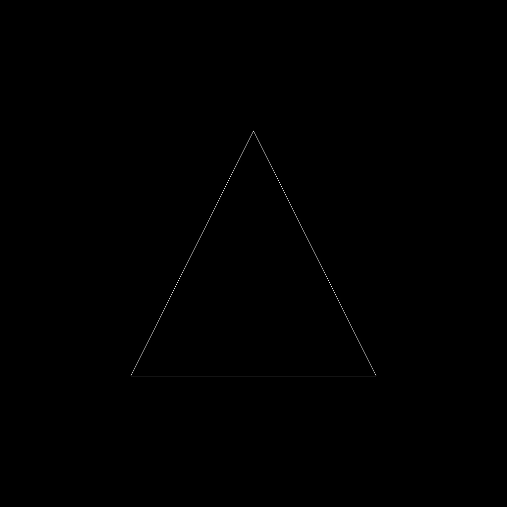
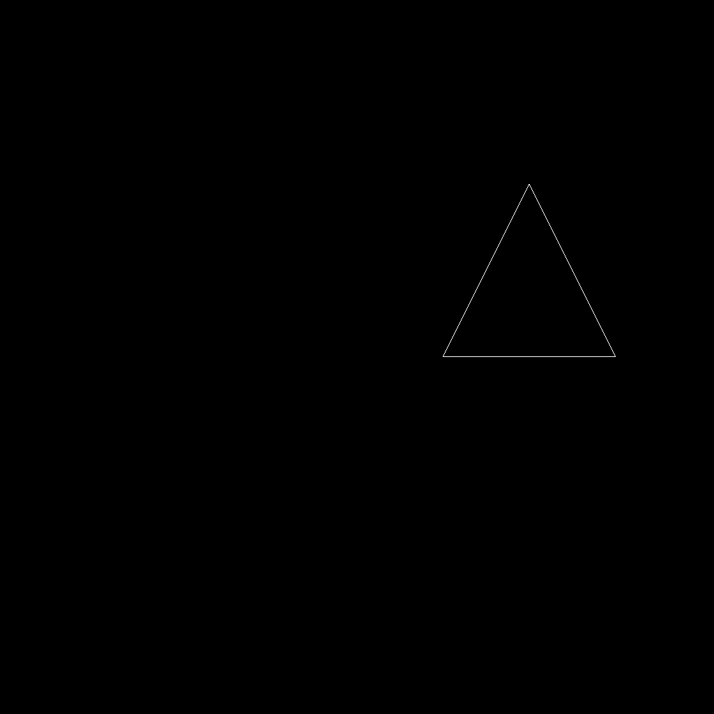
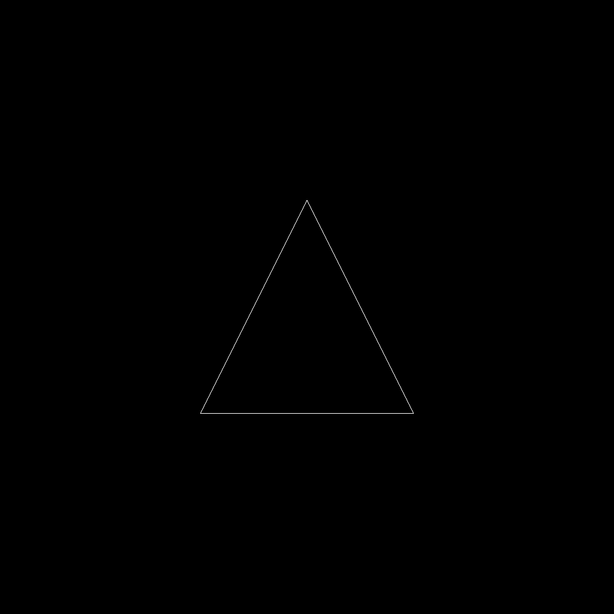
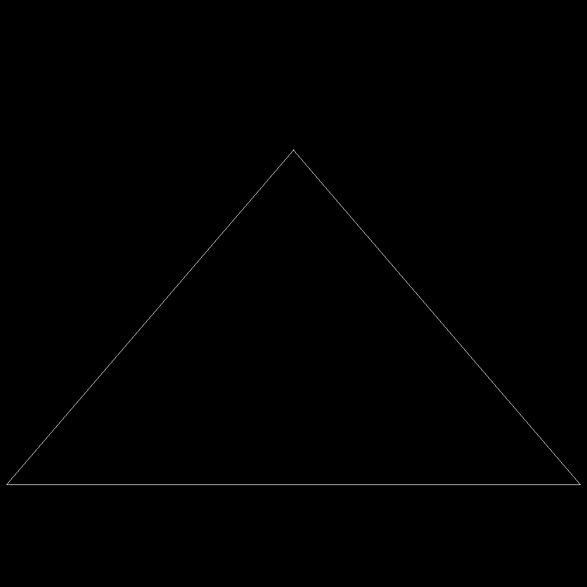

# Assignment 02

Name: HE, Xie

Student ID: 125090184

This assignment represents my own work in accordance with University regulations.

Signature: HE. Xie

### AI Usage Declaration

The key computer graphics implementations in this assignment, including the model
transformation, Rodrigues rotation, and perspective projection, were completed by me.
OpenAI Codex implemented the `main()` function and was used to test the project and provide
feedback. I reviewed the AI-assisted work and take responsibility for the submitted code and
report.

---

## 1. From Model to Screen

#### 1.1 Implement the Model Matrix

```cpp
bool check_axis(Vec3 axis) {
    return axis.allFinite() && std::isfinite(axis.norm()) && axis.norm() > 1e-6;
}

Mat4 get_rotation_matrix(float angle, Vec3 axis) {

    if (!check_axis(axis)) {
        std::ostringstream oss;
        oss << "Invalid rotation axis: " << axis.transpose().format(Eigen::IOFormat());
        throw std::invalid_argument(oss.str());
    }

    axis.normalize();

    Mat3 rotation_matrix_3 = 
    Mat3::Identity() * cosf(angle)
    + axis * axis.transpose() * (1 - cosf(angle))
    + get_cross_product_matrix(axis) * sinf(angle);

    return mat3_to_mat4(rotation_matrix_3);
}

Mat4 get_rotation_matrix(float angle, Vec3 P0, Vec3 P1) {
    Vec3 axis = (P1 - P0);
    
    return 
    get_translation_matrix(P0)
    * get_rotation_matrix(angle, axis)
    * get_translation_matrix(-P0);
}

Mat4 get_model_matrix(float rotation_angle, Vec3 T, Vec3 S, Vec3 P0, Vec3 P1)
{
    rotation_angle = rotation_angle * MY_PI / 180;

    Mat4 model_translation = get_translation_matrix(T);

    Mat4 model_scaling = get_scaling_matrix(S);

    Mat4 model_rotation = get_rotation_matrix(rotation_angle, P0, P1);

    Mat4 model_transform = model_translation * model_rotation * model_scaling;

    Vec3 axis = (P1 - P0).normalized();
    Eigen::AngleAxisf rotation_vector(rotation_angle, axis);
    Mat3 rotation_matrix_3 = rotation_vector.toRotationMatrix();

    Mat4 rotation_matrix_4 = mat3_to_mat4(rotation_matrix_3);
    rotation_matrix_4 = get_translation_matrix(P0) * rotation_matrix_4 * get_translation_matrix(-P0);

    if (!model_rotation.isApprox(rotation_matrix_4)) {
        throw std::logic_error(
            "Rodrigues rotation does not match Eigen::AngleAxisf");
    }

	return model_transform;
}
```

#### 1.2 Implement the Perspective Projection Matrix

```cpp
Mat4 get_perspective_to_orthogornal_matrix(float near, float far) {
    Mat4 mat;
    mat << 
    near, 0, 0, 0, 
    0, near, 0, 0, 
    0, 0, near+far, -near*far, 
    0, 0, 1, 0;
    return mat;
}

Mat4 get_orthogornal_projection_matrix(float ver_fov, float aspect_ratio, float near, float far) {
    float top = tanf(ver_fov/2) * -near;
    float right = top * aspect_ratio;

    Mat4 scaling, translation;
    scaling << 
    1/right, 0, 0, 0, 
    0, 1/top, 0, 0, 
    0, 0, 2/(far-near), 0,
    0, 0, 0, 1;
    translation << 
    1, 0, 0, 0, 
    0, 1, 0, 0, 
    0, 0, 1, -(far+near)/2, 
    0, 0, 0, 1;

    return scaling * translation;
}

Mat4 get_projection_matrix(float eye_fov, float aspect_ratio,
                                      float zNear, float zFar)
{
    float ver_fov = eye_fov * MY_PI / 180;

    Mat4 ortho, persp_to_ortho, projection;
    
    ortho = get_orthogornal_projection_matrix(ver_fov, aspect_ratio, -zNear, -zFar);
    
    persp_to_ortho = get_perspective_to_orthogornal_matrix(-zNear, -zFar);

    projection = ortho * persp_to_ortho;

    return projection;
}
```

#### 1.3 Implement main() According to Your Needs

The main function separates argument handling, scene initialization, frame rendering, and
interactive state updates. CLI11 is used to parse the initial rotation, output filename,
configuration file, and rendering mode. A one-shot render is selected when batch output
arguments are present; otherwise the program enters the interactive loop.

```cpp
CLI::App app{"Render a transformed triangle in batch or interactive mode"};

float angle = 0.0f;
bool interactive = false;
std::string output_filename = "result.png";
std::string config_filename = "config/config.json";
std::string legacy_output_filename;
std::string legacy_config_filename;

CLI::Option* rotation_option = app.add_option(
    "-r,--rotation", angle, "Initial model rotation angle in degrees");
CLI::Option* output_option = app.add_option(
    "-o,--output", output_filename, "Output PNG filename");
app.add_option("-c,--config", config_filename, "JSON configuration file");
app.add_flag("-i,--interactive", interactive,
             "Open the interactive window instead of rendering one image");
app.add_option("OUTPUT_FILE", legacy_output_filename,
               "Legacy positional output filename used after -r <angle>");
app.add_option("CONFIG_FILE", legacy_config_filename,
               "Legacy positional configuration filename");

try {
    app.parse(argc, argv);
}
catch (const CLI::ParseError& error) {
    return app.exit(error);
}

const bool command_line = !interactive &&
    (rotation_option->count() != 0 || output_option->count() != 0 ||
     !legacy_output_filename.empty());
```

All scene and transformation parameters are loaded from the selected JSON configuration.
The triangle vertices are then uploaded to the rasterizer, while the initial mutable values
are retained so that the interactive state can be restored later.

```cpp
constexpr int width = 1024;
constexpr int height = 1024;
cfg::Config config(config_filename, command_line, angle, output_filename);
rst::rasterizer rasterizer(width, height);

const Vec3 eye_pos = vec4_to_vec3(config.get_eye_pos());
const Triangle triangle = config.get_triangle();
const std::vector<Vec3> positions{
    {triangle.a()}, {triangle.b()}, {triangle.c()}
};
const std::vector<Eigen::Vector3i> indices{{0, 1, 2}};
const auto pos_id = rasterizer.load_positions(positions);
const auto ind_id = rasterizer.load_indices(indices);

Vec3 translation = config.get_T();
Vec3 scale = config.get_S();
const Vec3 P0 = config.get_P0();
const Vec3 P1 = config.get_P1();
float eye_fov = config.get_eye_fov();
const float aspect_ratio = config.get_aspect_ratio();
const float zNear = config.get_zNear();
const float zFar = config.get_zFar();

const float initial_angle = angle;
const Vec3 initial_translation = translation;
const Vec3 initial_scale = scale;
const float initial_eye_fov = eye_fov;
```

A lambda implements the common frame-rendering pipeline. Both rendering modes therefore use
the same model, view, and projection calculations and the same framebuffer conversion.

```cpp
auto render_frame = [&]() {
    rasterizer.clear(rst::Buffers::Color | rst::Buffers::Depth);
    rasterizer.set_model(
        get_model_matrix(angle, translation, scale, P0, P1));
    rasterizer.set_view(get_view_matrix(eye_pos));
    rasterizer.set_projection(
        get_projection_matrix(eye_fov, aspect_ratio, zNear, zFar));
    rasterizer.draw(pos_id, ind_id, rst::Primitive::Triangle);

    cv::Mat float_image(height, width, CV_32FC3,
                        rasterizer.frame_buffer().data());
    cv::Mat image;
    float_image.convertTo(image, CV_8UC3, 1.0f);
    return image;
};

if (command_line) {
    const cv::Mat image = render_frame();
    save_image(output_filename, image);
    return 0;
}
```

In interactive mode, each input event changes the current transformation state. Translation,
uniform scaling, rotation, and field of view are updated independently. Reset restores the
values captured from the initial arguments and configuration, while snapshots use a numbered
filename selected without overwriting an existing image.

```cpp
while (key != 27) {
    const cv::Mat image = render_frame();
    cv::imshow("Transformation - press h for help", image);
    key = cv::waitKey(10) & 0xff;

    switch (key) {
    case 'a': angle += 10.0f; break;
    case 'd': angle -= 10.0f; break;
    case 'j': translation.x() -= translation_step; break;
    case 'l': translation.x() += translation_step; break;
    case 'w': translation.y() += translation_step; break;
    case 's': translation.y() -= translation_step; break;
    case 'q': translation.z() += translation_step; break;
    case 'e': translation.z() -= translation_step; break;
    case '+': scale *= scale_factor; break;
    case '-': scale /= scale_factor; break;
    case '[': eye_fov = std::max(1.0f, eye_fov - fov_step); break;
    case ']': eye_fov = std::min(179.0f, eye_fov + fov_step); break;
    case 'r':
        angle = initial_angle;
        translation = initial_translation;
        scale = initial_scale;
        eye_fov = initial_eye_fov;
        break;
    case 'p': {
        std::string snapshot_filename;
        do {
            snapshot_filename =
                make_snapshot_filename(output_filename, snapshot_index++);
        } while (std::filesystem::exists(snapshot_filename));
        save_image(snapshot_filename, image);
        break;
    }
    }
}

```

## 2. Configuration

The scene parameters are stored in JSON files and loaded by the `Config` class. This keeps
the geometry, camera, projection, and model transformation independent from the rendering
code. The four configurations are designed so that each result isolates a different part of
the transformation pipeline. All saved results in this section use a rotation angle of
$0^\circ$.

#### 2.1 Configuration Structure and Common Parameters

Each configuration contains the following groups of values:

| Group | JSON fields | Purpose |
|---|---|---|
| Camera | `eye_pos` | Homogeneous world-space position of the camera. The camera looks along the negative z-axis. |
| Triangle | `vertices`, `colors`, `tex_coords`, `normals` | Complete per-vertex data used to construct the triangle. The current renderer draws its wireframe. |
| Projection | `eye_fov`, `aspect_ratio`, `zNear`, `zFar` | Defines the symmetric perspective viewing frustum. |
| Model transform | `T`, `S` | Translation vector and per-axis scaling factors. |
| Rotation axis | `P0`, `P1` | Defines the axis through $P_0$ in direction $P_1-P_0$. |

All four files use a square aspect ratio and the same clipping distances:

```json
{
    "aspect_ratio": 1.0,
    "zNear": 0.1,
    "zFar": 100.0,
    "P0": [0.0, 0.0, 0.0],
    "P1": [0.0, 1.0, 0.0]
}
```

Therefore, the common rotation axis is the y-axis through the origin. Keeping these values
fixed makes the effects of translation, scaling, field of view, and vertex depth directly
comparable.

#### 2.2 Baseline Scene: `config.json`

The default file defines a symmetric triangle in the plane $z=0$. The camera is five units
in front of the origin, while the identity translation and scaling leave the triangle in its
original model-space position.

| Parameter | Value |
|---|---|
| Eye position | $(0, 0, 5, 1)$ |
| Triangle vertices | $(0,1,0)$, $(-1,-1,0)$, $(1,-1,0)$ |
| Vertical FOV | $45^\circ$ |
| Translation $T$ | $(0,0,0)$ |
| Scaling $S$ | $(1,1,1)$ |
| Rotation angle | $0^\circ$ |

All vertices are five units from the camera along its viewing direction. The result is a
centered, vertically symmetric reference triangle that serves as the baseline for the other
configurations.



#### 2.3 Model Scaling and Translation: `config1.json`

This configuration retains the baseline camera, projection, triangle, and rotation axis, but
changes the model transformation to

$$
T=(1,0.5,0), \qquad S=(0.5,0.5,1).
$$

Because the model matrix applies scaling before translation when the rotation angle is zero,
the transformed vertices are:

| Original vertex | After scaling and translation |
|---|---|
| $(0,1,0)$ | $(1,1,0)$ |
| $(-1,-1,0)$ | $(0.5,0,0)$ |
| $(1,-1,0)$ | $(1.5,0,0)$ |

The output is consequently half the baseline width and height and is displaced toward the
upper-right portion of the screen. This configuration specifically verifies the order and
combined effect of the model scaling and translation matrices.



#### 2.4 Field of View Comparison: `config2.json`

This file restores the identity model transformation and uses the same triangle and eye
position as the baseline. Its only geometrically significant change is the vertical field of
view:

| Parameter | Baseline | `config2.json` |
|---|---:|---:|
| Vertical FOV | $45^\circ$ | $60^\circ$ |
| Eye position | $(0,0,5,1)$ | $(0,0,5,1)$ |
| Translation | $(0,0,0)$ | $(0,0,0)$ |
| Scaling | $(1,1,1)$ | $(1,1,1)$ |

A larger FOV covers a wider region of the scene. With the object distance unchanged, the
triangle therefore occupies a smaller portion of the screen than in the baseline result.
This isolates the visible effect of `eye_fov` in the perspective projection matrix.



#### 2.5 Perspective from Different Vertex Depths: `config3.json`

The final configuration moves the eye closer to the origin, increases the FOV, and defines a
triangle whose vertices do not share the same z-coordinate.

| Parameter | Value |
|---|---|
| Eye position | $(0,0,3,1)$ |
| Triangle vertices | $(0,1.5,-1)$, $(-1.5,-1,1)$, $(1.5,-1,1)$ |
| Vertical FOV | $75^\circ$ |
| Translation $T$ | $(0,0,0)$ |
| Scaling $S$ | $(1,1,1)$ |
| Rotation angle | $0^\circ$ |

After view translation, the top vertex has view-space $z=-4$, whereas the two lower vertices
have $z=-2$. The lower edge is therefore twice as close to the camera as the top vertex.
Perspective division makes the closer lower vertices spread farther apart on the screen,
producing a wide base and visibly demonstrating depth-dependent perspective foreshortening.



#### 2.6 Configuration Comparison

| File | Main parameter change | Intended observation |
|---|---|---|
| `config.json` | Identity model transform, $45^\circ$ FOV | Centered reference triangle |
| `config1.json` | $0.5$ x/y scale and positive x/y translation | Smaller triangle shifted upward and right |
| `config2.json` | FOV increased from $45^\circ$ to $60^\circ$ | Same object appears smaller |
| `config3.json` | Closer eye and vertices at different z-depths | Strong perspective caused by different camera distances |
