# Assignment 03

Name: HE, Xie

Student ID: 125090184

This assignment represents my own work in accordance with University regulations.

Signature: HE, Xie

### AI Usage Declaration

The key computer graphics implementations in this assignment, including triangle rasterization, supersampling, the affine transforms, barycentric color interpolation, texture pixel sampling, and mipmap level sampling, were completed by me. Deepseek V4.1 Flash was used to test the project and provide feedback, to carry out a large-scale API refactoring (the shared `rasterize_triangle_shaded` loop and the geometry helpers moved into `src/utils`), and to update the report so that its code listings and technical descriptions stay consistent with the code; these report edits are based on the source code and do not touch my own reflections and discussion. I reviewed the AI-assisted work and take responsibility for the submitted code and report.

---

## 1. Overview

This assignment builds a complete software rasterizer on top of the existing SVG parsing and transform framework. The rendering pipeline is:

1. `SVGParser` parses the `.svg` file into an `SVG` object.
2. `DrawRend::redraw` calls `SVG::draw`, dispatching each primitive to the point / line / triangle rasterization functions.
3. Triangle rasterization writes colors into `RasterizerImp::sample_buffer`.
4. `RasterizerImp::resolve_to_framebuffer` resolves `sample_buffer` (floating-point `Color`) into the 8-bit `rgb_framebuffer_target` that is displayed and saved.

Six tasks were completed on top of this pipeline: single-color triangle rasterization (Task 1), supersampling antialiasing (Task 2), affine transforms (Task 3), barycentric color interpolation (Task 4), texture pixel sampling (Task 5), and mipmap level sampling (Task 6). In addition, the Task 1 extra credit — drawing a triangle "A" over a triangle "B" (both with an alpha channel) using a z-buffer — was implemented on top of the same loop (Section 2.4), the alpha compositing included.

To keep the code DRY, I moved four geometry helpers — `bounding_box`, `area_triangle`, `barycentric_coordinates`, and `point_in_triangle` — into `src/utils.{h,cpp}`, and made the triangle rasterization of Tasks 1, 2, 4, 5, and 6 share one templated main loop, `rasterize_triangle_shaded(x0..y2, z0..z2, shade)`. The loop performs the bounding-box traversal, the `n x n` supersampling, and the coverage compositing; the `shade(sx, sy, alpha, beta, gamma)` callback returns the color of a single subsample. Single-color triangles, vertex-color interpolation, and texture sampling therefore all reuse the same traversal logic. Section 2.4 extends this loop with a depth test and alpha accumulation.

Also, a consistent and clearly documented coordinate convention is very important for correct behavior. For example, the statement `int tx = clamp((int)round(uv.x * (mip.width - 1)), 0, (int)mip.width - 1);` relies on an undocumented assumption about how UV coordinates map to texel indices, which caused me trouble during my implementation.

```cpp
template <typename ShadeFn>
void RasterizerImp::rasterize_triangle_shaded(
    float x0, float y0, float z0,
    float x1, float y1, float z1,
    float x2, float y2, float z2,
    ShadeFn shade)
{
  auto [minX, maxX, minY, maxY] =
      bounding_box(x0, y0, x1, y1, x2, y2, (int)width, (int)height);
  if (sample_rate == 0) return;

  unsigned int n = sqrt((double)sample_rate);
  float inverse_sample_rate = 1.0f / (float)sample_rate;

  for (int y = minY; y <= maxY; ++y) {
    for (int x = minX; x <= maxX; ++x) {
      float Asum = 0.0f;
      Color accum(0, 0, 0);
      for (unsigned int i = 0; i < n; ++i) {
        for (unsigned int j = 0; j < n; ++j) {
          float sx = x + (i + 0.5f) / n;
          float sy = y + (j + 0.5f) / n;
          float alpha, beta, gamma;
          if (point_in_triangle(sx, sy, x0, y0, x1, y1, x2, y2,
                                alpha, beta, gamma)) {
            float sz = alpha * z0 + beta * z1 + gamma * z2;
            if (sz < sample_buffer_depth[y * width + x] ||
                fabs(sample_buffer_depth[y * width + x] - sz) < 1e-6) {
              sample_buffer_depth[y * width + x] = sz;
            } else {
              continue;
            }
            Color c = shade(sx, sy, alpha, beta, gamma);
            float ca = clamp(c.a, 0.0f, 1.0f);
            if (fabs(ca - 1.0f) < 1e-6) { ca = 1.0f; }
            accum += Color(c.r * ca, c.g * ca, c.b * ca);
            Asum += ca;
          }
        }
      }
      if (Asum == 0) continue;
      Color& dst = sample_buffer[y * width + x];
      dst = accum * inverse_sample_rate + dst * (1.0f - Asum * inverse_sample_rate);
      dst.a = 1.0f;
    }
  }
}
```

## 2. Task 1: Drawing Single-Color Triangles

#### 2.1 Bounding Box

`rasterize_triangle` revisits only the pixels inside the triangle's bounding box, clamped to the screen. Its cost is therefore proportional to the on-screen area of the triangle rather than to the size of the framebuffer, which satisfies the requirement of being "no worse than checking each sample within the bounding box".

```cpp
tuple<int, int, int, int> bounding_box(float x0, float y0, float x1, float y1, float x2, float y2, int width, int height) {
  int minX = max(0.0f, floor(min(x0, min(x1, x2))));
  int maxX = min((float)(width  - 1), floor(max(x0, max(x1, x2))));
  int minY = max(0.0f, floor(min(y0, min(y1, y2))));
  int maxY = min((float)(height - 1), floor(max(y0, max(y1, y2))));
  return { minX, maxX, minY, maxY };
}
```

#### 2.2 Point-in-Triangle Test and Winding Order

For each pixel I sample its center, `(x + 0.5, y + 0.5)`. Whether the sample is inside the triangle is decided with the signed areas of the three subtriangles:

$$
\alpha=\frac{\text{area}(P,B,C)}{\text{area}(A,B,C)},\quad
\beta=\frac{\text{area}(P,C,A)}{\text{area}(A,B,C)},\quad
\gamma=\frac{\text{area}(P,A,B)}{\text{area}(A,B,C)}.
$$

A sample on the boundary is considered inside (`>= 0`), so no edge is ever left un-rasterized. Because the three numerators all flip sign together with the denominator when the winding order changes, the same test works for clockwise and counter-clockwise triangles (verified with `svg/basic/test6.svg`).

```cpp
tuple<float, float, float> barycentric_coordinates(
    float x, float y, float x0, float y0, float x1, float y1, float x2, float y2) {
  float areaABC = area_triangle(x0, y0, x1, y1, x2, y2);
  float areaPBC = area_triangle(x,  y,  x1, y1, x2, y2);
  float areaPCA = area_triangle(x,  y,  x2, y2, x0, y0);
  float areaPAB = area_triangle(x,  y,  x0, y0, x1, y1);
  if (areaABC == 0) return { -1.0f, -1.0f, -1.0f };
  return { areaPBC / areaABC, areaPCA / areaABC, areaPAB / areaABC };
}

bool point_in_triangle(float x, float y, float x0, float y0, float x1, float y1, float x2, float y2, float& alpha, float& beta, float& gamma) {
  tie(alpha, beta, gamma) = barycentric_coordinates(x, y, x0, y0, x1, y1, x2, y2);
  return (alpha >= 0 && beta >= 0 && gamma >= 0);
}
```

`rasterize_triangle` then simply hands a constant color to the shared loop:

```cpp
void RasterizerImp::rasterize_triangle(
    float x0, float y0, float z0,
    float x1, float y1, float z1,
    float x2, float y2, float z2,
    Color color) {
  rasterize_triangle_shaded(x0, y0, z0, x1, y1, z1, x2, y2, z2,
    [&](float, float, float, float, float) { return color; });
}
```

#### 2.3 Results

`svg/basic/test4.svg` rendered with the default viewing parameters:

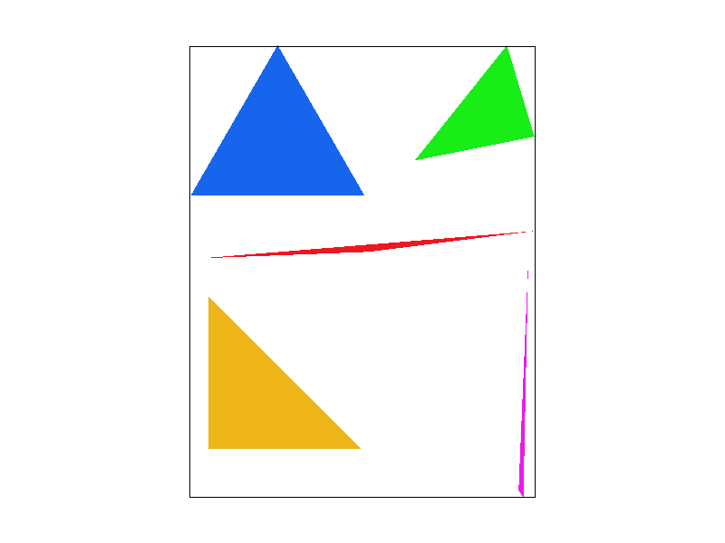

The pixel inspector centered on a thin corner of a triangle confirms that boundary pixels are filled completely and that no edge is skipped:

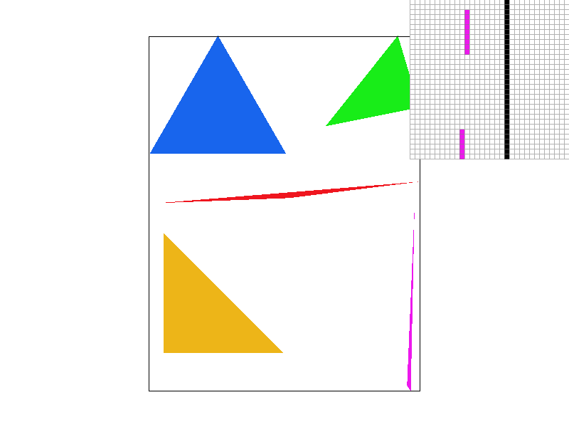

#### 2.4 Extra Credit: Z-buffer with Alpha

**Implemented.** The extra credit asks to draw a triangle "A" over another triangle "B" (both with an alpha channel) using a z-buffer. Both halves are implemented: occlusion is decided by interpolated depth instead of draw order, and `Color` carries an alpha channel that is composited with the standard source-over operator.

**Depth buffer.**

- **Storage and convention.** A per-pixel depth buffer `sample_buffer_depth` (`std::vector<float>`, `width × height`) is added alongside `sample_buffer`. It is initialized to `+∞` ("nothing drawn yet") in the constructor, on every framebuffer target / sample-rate change, and in `clear_buffers`. Smaller z means closer to the viewer.
- **Depth test inside the shared loop.** Each subsample interpolates the per-vertex z barycentrically — `sz = α·z0 + β·z1 + γ·z2`, exactly like Task 4's color interpolation — and is shaded only if it passes the test below. Occluded subsamples are simply not counted toward `Asum`, so the Task 2 coverage compositing is untouched and a far primitive's compositing weight automatically shrinks to its visible part.
- **Painter's-algorithm backward compatibility.** The test accepts a new sample when it is strictly nearer **or** ties within an epsilon; ties therefore go to the primitive drawn later. Every existing SVG file has no z attributes, so all primitives get depth 0 and every test is a tie, so the depth test degenerates exactly to the painter's order (regression renders confirm the existing test files are unchanged). Points and lines write depth 0 in `fill_pixel`, so they always sit on top (this keeps, e.g., the black canvas border in `test4.svg` visible, as it is drawn last).
- **z and transforms.** A 3×3 affine transform cannot map depth, so per-vertex z is forwarded unchanged in screen space. On the SVG side, `Triangle` gains `z0/z1/z2` (default 0) passed through `colortri`/`textri`, and `Rect`/`Polygon` gain a scalar `z` expanded to the three vertices. Both are optional attributes (`zs="z0 z1 z2"` and `z="..."`) parsed with proper presence checks, defaulting to 0.

The test is a small addition to the shared rasterization loop:

```cpp
float sz = alpha * z0 + beta * z1 + gamma * z2;
if (sz < sample_buffer_depth[y * width + x] ||
    fabs(sample_buffer_depth[y * width + x] - sz) < 1e-6) {
  sample_buffer_depth[y * width + x] = sz;        // pass: nearer, or tied (later wins)
} else {
  continue;  // occluded subsample: not shaded, not counted
}
Color c = shade(sx, sy, alpha, beta, gamma);
float ca = clamp(c.a, 0.0f, 1.0f);                // clamp opacity to [0,1]
if (fabs(ca - 1.0f) < 1e-6) { ca = 1.0f; }        // near-opaque -> exactly opaque
accum += Color(c.r * ca, c.g * ca, c.b * ca);     // premultiplied colour sum
Asum  += ca;                                      // opacity sum
// ... after the subsample loops:
dst = accum * inverse_sample_rate + dst * (1.0f - Asum * inverse_sample_rate);
```

**Alpha compositing.**

- **Where alpha comes from.** `Color` (in CGL) gained a fourth component `a`, defaulting to 1, so every pre-existing construction is opaque; the arithmetic operators now propagate all four components, which makes Task 4's interpolation `c0·α + c1·β + c2·γ` interpolate alpha for free. The single alpha source is the optional 4th component of a `colortri`'s `colors` attribute (`colors="r g b a  ..."`), which the parser previously discarded. Textures, points, lines and shapes stay opaque: `Color::fromHex` and the RGB→`Color` array constructor set `a = 1`.
- **Model: source-over.** Each shaded subsample is composited over the resolved pixel colour with `out = a·src + (1−a)·dst`. Since every subsample of a pixel is composited over the *same* `dst`, the "over" operators factor out of the coverage average: the loop only needs a premultiplied colour sum `Σ a·c` and an opacity sum `Σ a`, and the compositing line becomes `dst = accum·inv + dst·(1 − Asum·inv)` — the same shape as the Task 2 formula with the coverage weight replaced by the opacity sum.
- **Opaque exactness.** Interpolating a constant `a = 1` through the barycentric weights is not exactly `1.0f` (`α+β+γ` rounds to about 1e-7), which perturbed six 8-bit channels by one level in the opaque `test7.svg`. Quantizing near-opaque alpha to exactly 1 (threshold 1e-6, i.e. far below one 8-bit level) makes fully opaque geometry reduce bit-for-bit to the pre-alpha formula, so all pre-existing files render byte-identically (verified).
- **Interaction with the z-buffer.** Equal depth (within 1e-6) passes the test, so at the same z the later triangle blends over the earlier one — exactly the extra-credit "A over B" case, with A drawn second. A nearer triangle (optionally translucent) blends over whatever is already in the buffer, and a farther triangle is culled. Note that "over" is not commutative, so at equal depth the result follows draw order rather than being order-independent. Documented limitation: a translucent triangle drawn *after* a nearer opaque one is depth-culled and does not show through it (order-independent transparency is out of scope).

**Granularity choice.** Because Task 2 chose the coverage-compositing buffer (one color per pixel), I store one depth per pixel while still testing per subsample; this works for any `sample_rate` (verified at 4×). A full per-sample depth buffer is not required for opaque occlusion, and this keeps the Task 2 memory extra credit intact. The residual limitation is inherited from the coverage scheme rather than the depth test: on an occlusion contour where the far triangle was drawn *first* and both triangles partially cover the same pixel, the far color already composited keeps its old weight on the subsamples the near triangle takes over, leaving a faint far-color fringe along the silhouette — the same coverage-weighting effect as the seam discussed in Section 3.4.

**Results.** `svg/extra/zbuffer.svg` draws the red triangle (z = 0.2) **first** and the blue triangle (z = 0.8) **last**. Painter's order would put blue in the overlap; the z-buffer keeps red:

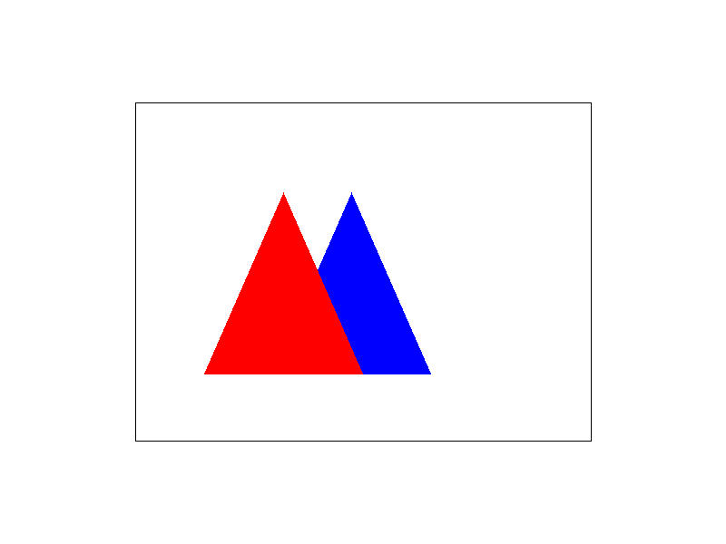

`zbuffer_rev.svg` draws the same two triangles in the opposite order. Its render is byte-identical (same PNG checksum), demonstrating that the result is now independent of draw order:


`zbuffer_tri.svg` exercises per-vertex z: red (flat z = 0.2) and blue (flat z = 0.8) are drawn first, then a cyan triangle with an interpolated z ramp 0.1 (base) → 0.5 (apex) is drawn last. Below the z = 0.2 isoline the cyan triangle wins; above it the red triangle stays visible although cyan was drawn after it; cyan always beats blue (z ≤ 0.5 < 0.8):

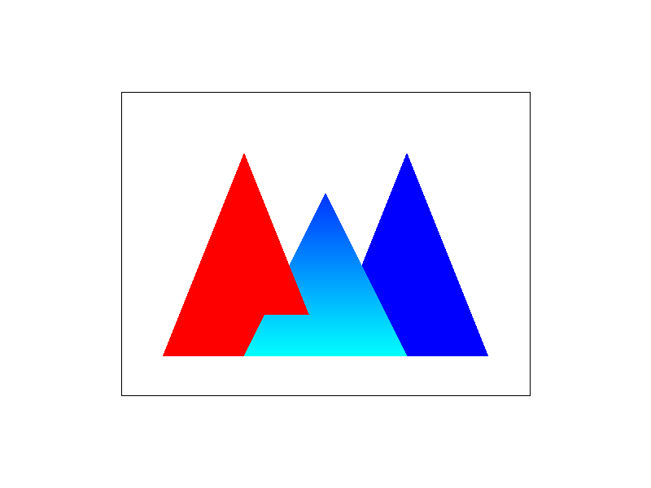

`svg/extra/alpha.svg` is the extra-credit scene itself: opaque blue **B** is drawn first, then red **A** with `alpha = 0.5` at the **same z**, so the equal-depth rule lets A blend over B. The overlap is purple (`0.5·red + 0.5·blue`), A alone is pink (`0.5·red + 0.5·white`) and B alone is blue — probed as `(127,0,127)`, `(255,127,127)` and `(0,0,255)`:

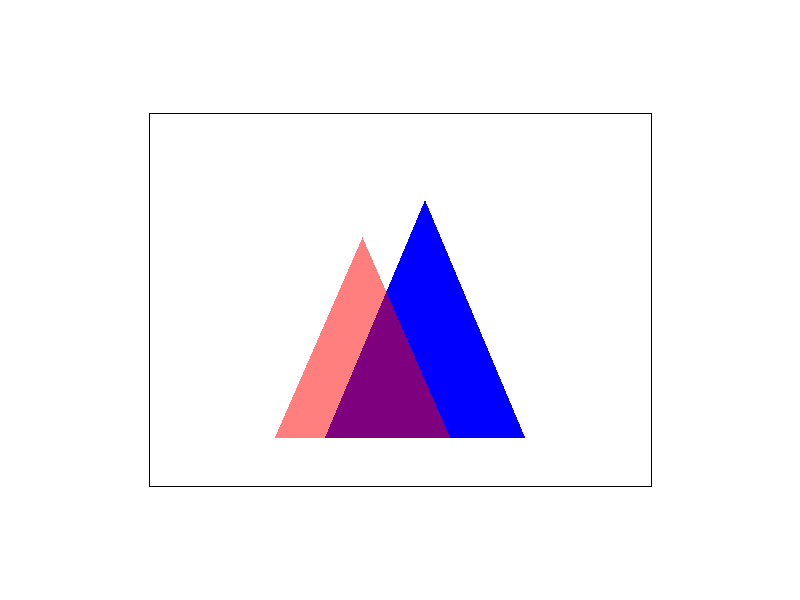

Beyond the visual checks, I validated the implementation with (i) 21 unit tests driving `RasterizerImp` directly — bidirectional occlusion, tie-breaking, an interpolated-ramp crossing, 4× supersampling, point-on-top, plus the opacity cases (alpha over the background, opaque-over-opaque at equal z, the non-commutativity of "over", a nearer translucent triangle over a farther opaque one, the far-translucent cull limit, `a = 0`, and interpolated per-vertex alpha) — and (ii) offscreen `SVGParser → DrawRend` renders with per-pixel probes. The two order-swapped z-buffer renders are byte-identical, and the six pre-existing test files (test3, test4, test7, robot, texmap/test1, 07_lines) render byte-identically to the pre-alpha build.

## 3. Task 2: Antialiasing

#### 3.1 Supersampling Algorithm

I use **coverage compositing**. `sample_buffer` still stores exactly one `Color` per pixel, independent of `sample_rate`. For every pixel inside the bounding box:

1. Let $n=\sqrt{\text{sample\_rate}}$ and place an $n\times n$ grid of subsamples over the pixel at $sx = x + (i+0.5)/n$, $sy = y + (j+0.5)/n$.
2. Count the covered subsamples (`Asum`) and accumulate their colors (`accum`).
3. Composite with the coverage $\text{cov} = \text{Asum}/\text{sample\_rate}$: `dst = accum * (1/sample_rate) + dst * (1 - cov)`.

The core of this is the `rasterize_triangle_shaded` loop shown in Section 1.

#### 3.2 Pipeline Changes

- `set_sample_rate(rate)` and `set_framebuffer_target(w, h)` resize `sample_buffer` whenever the sampling rate or the framebuffer dimensions change.
- `clear_buffers()` erases the frame (white background) before each redraw.
- `resolve_to_framebuffer()` linearly maps the floating-point `Color` to 8 bits.
- `fill_pixel(x, y, c)` writes a single slot; points and lines therefore still render correctly at any supersampling rate, since all subsamples of a pixel receive the same color. (Points and lines are not antialiased, as permitted.)

```cpp
void RasterizerImp::resolve_to_framebuffer() {
  for (int x = 0; x < width; ++x) {
    for (int y = 0; y < height; ++y) {
      int pixel_index = y * width + x;
      int rgb_index = 3 * pixel_index;
      Color col = sample_buffer[pixel_index];
      for (int k = 0; k < 3; ++k)
        this->rgb_framebuffer_target[rgb_index + k] = col[k] * 255;
    }
  }
}
```

#### 3.3 Results

`svg/basic/test4.svg` at sample rates 1, 4, and 16 (the pixel inspector is placed on a very thin triangle corner, where the effect is most dramatic):

| sample_rate = 1                   | sample_rate = 4                   | sample_rate = 16                    |
| --------------------------------- | --------------------------------- | ----------------------------------- |
| 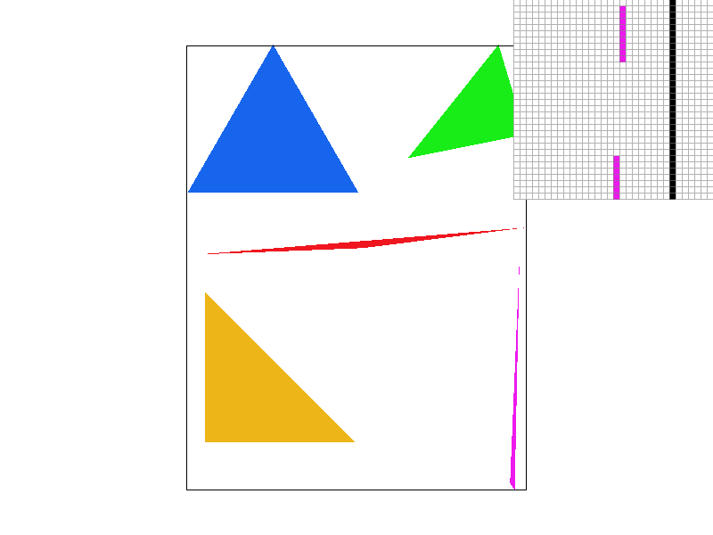 | 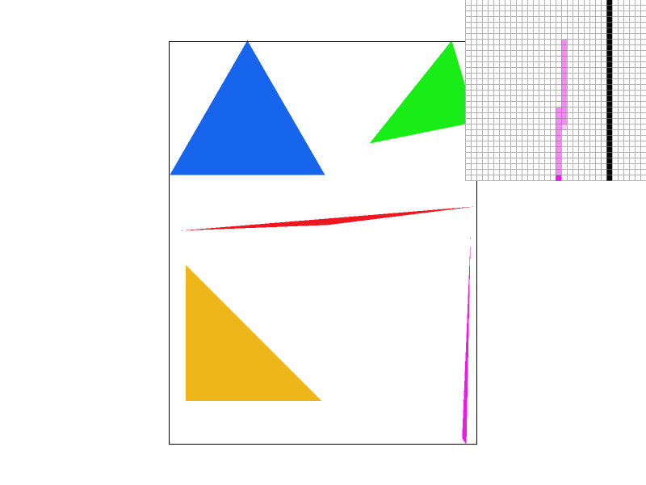 |  |

At rate 1 the thin corner is clearly stair-stepped. At rate 4 intermediate gray levels appear along the edge and the aliasing is much reduced. At rate 16 the transition is smoother still, but the improvement is diminishing. This is because the number of distinct coverage levels grows with $n$: rate 1 yields only {0, 1}, rate 4 yields 5 levels, and rate 16 yields 17 levels. More levels mean smoother edge transitions, at a cost proportional to `sample_rate`.

#### 3.4 Extra Credit: Memory Reduction (5 pts)

**Implemented.** Because the buffer stores one resolved color per pixel, its size is always $width\times height$ — identical to the non-supersampled case — and does not grow with `sample_rate`. The trade-off is that a pixel keeps only its final color rather than its individual subsamples.

Compared with a full per-sample buffer (`width x height x sample_rate`, each subsample storing its own color), the coverage scheme gives up:

1. **Correct antialiasing of overlapping / adjacent geometry.** A per-sample buffer assigns each sample to exactly one surface (the last triangle to cover it in draw order). Along a shared edge, two adjacent triangles each blend with the background once, producing an approximate seam `0.5B + 0.25A + 0.25*bg`; a per-sample buffer assigns half the samples to A and half to B and stays clean.
2. **A per-sample depth buffer (z-buffer).** This enables sub-pixel occlusion and MSAA-style variants (store only a depth/coverage mask and shade once per pixel). The Task 1 z-buffer extra credit did not need this: it is implemented with a per-pixel depth buffer plus per-subsample depth tests (Section 2.4), which preserves the coverage scheme's memory footprint.

In short, the coverage scheme trades memory (and the correctness of overlapping geometry) for a footprint equal to the plain framebuffer, which is the point of this extra credit. The alternative antialiasing methods extra credit (5 pts) was **not** implemented.

## 4. Task 3: Transforms

#### 4.1 Implementation

The three 3x3 homogeneous matrices are implemented in `src/transforms.cpp`. The overloaded `operator*` promotes a `Vector2D` to `(x, y, 1)`, applies the matrix, and divides by the homogeneous coordinate.

```cpp
Matrix3x3 translate(float dx, float dy) {
  return Matrix3x3(1, 0, dx,
                   0, 1, dy,
                   0, 0, 1);
}

Matrix3x3 scale(float sx, float sy) {
  return Matrix3x3(sx, 0, 0,
                   0, sy, 0,
                   0, 0, 1);
}

// The input argument is in degrees counterclockwise.
Matrix3x3 rotate(float deg) {
  float rad = deg * M_PI / 180.0;
  return Matrix3x3(cos(rad), -sin(rad), 0,
                   sin(rad),  cos(rad), 0,
                   0,        0,        1);
}
```

#### 4.2 Results

`svg/transforms/robot.svg` renders correctly. I also created `docs/my_robot.svg`, a "waving" variant of the cubeman: I raised his left arm overhead to make him wave, recolored him entirely blue, and kept his overall proportions; the rendered result is shown next to the original.

| `svg/transforms/robot.svg`       | `docs/my_robot.svg`                    |
| -------------------------------- | -------------------------------------- |
| 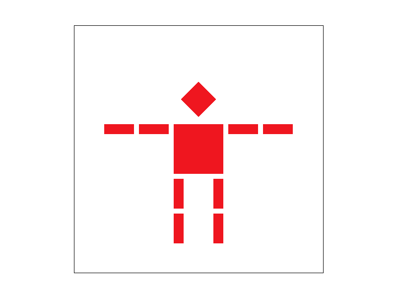 | 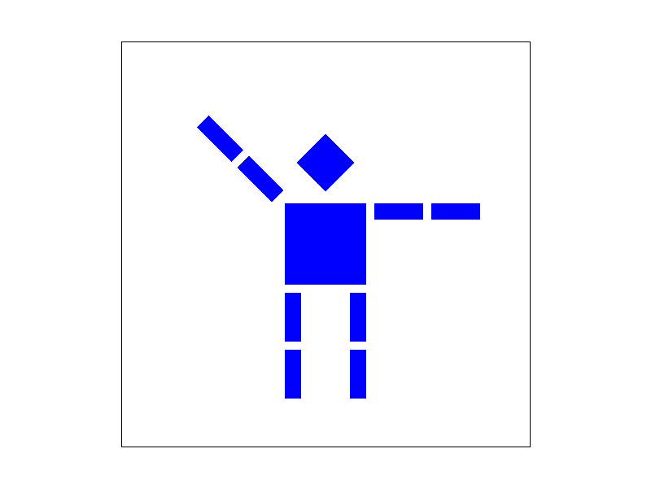 |

## 5. Task 4: Barycentric Coordinates

#### 5.1 Explanation

For any point $P$ in the plane of triangle $ABC$, the barycentric coordinates $(\alpha, \beta, \gamma)$ satisfy

$$
P = \alpha A + \beta B + \gamma C, \qquad \alpha + \beta + \gamma = 1.
$$

Geometrically, $\alpha$ is the ratio of the area of subtriangle $PBC$ to the area of $ABC$, and similarly for $\beta$ and $\gamma$. Hence all three coordinates are non-negative exactly when $P$ lies inside the triangle, and the same triple linearly interpolates any per-vertex attribute across the triangle. For a triangle whose vertices are red, green, and blue, the interior color $C(P) = \alpha C_0 + \beta C_1 + \gamma C_2$ is a smooth three-color gradient. The color-wheel image in Section 5.2, made of many such triangles, illustrates this gradient directly.

#### 5.2 Implementation and Results

`rasterize_interpolated_color_triangle` reuses the shared loop and interpolates the vertex colors with the barycentric coordinates of each subsample:

```cpp
rasterize_triangle_shaded(x0, y0, z0, x1, y1, z1, x2, y2, z2,
  [&](float, float, float alpha, float beta, float gamma) {
    return c0 * alpha + c1 * beta + c2 * gamma;
  });
```

`svg/basic/test7.svg` at the default parameters and sample rate 1 shows the color wheel:

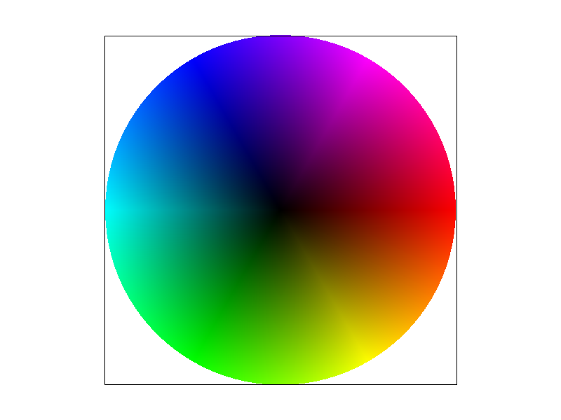

## 6. Task 5: Pixel Sampling for Texture Mapping

#### 6.1 Nearest and Bilinear Sampling

Given per-vertex texture coordinates $(u, v) \in [0,1]^2$, the pixel's $(u, v)$ is obtained by barycentric interpolation and then looked up in the texture:

- **Nearest:** map $(u, v)$ to the closest texel center. Fast, but blocky when magnified and aliased (moiré) when minified.
- **Bilinear:** average the four surrounding texels with weights given by the fractional position (interpolate along $u$, then along $v$). Smoother edges when magnified and some antialiasing when minified, at the cost of a slightly blurrier texture.

#### 6.2 Implementation

`MipLevel` stores RGB texels; `get_texel` provides indexed access.

```cpp
Color Texture::sample_nearest(Vector2D uv, int level) {
  auto& mip = mipmap[level];
  int tx = clamp((int)round(uv.x * (mip.width  - 1)), 0, (int)mip.width  - 1);
  int ty = clamp((int)round(uv.y * (mip.height - 1)), 0, (int)mip.height - 1);
  return mip.get_texel(tx, ty);
}

Color Texture::sample_bilinear(Vector2D uv, int level) {
  auto& mip = mipmap[level];
  float fx = uv.x * (mip.width  - 1);
  float fy = uv.y * (mip.height - 1);
  int tx = clamp((int)floor(fx), 0, (int)mip.width  - 1);
  int ty = clamp((int)floor(fy), 0, (int)mip.height - 1);
  int tx1 = clamp(tx + 1, 0, (int)mip.width  - 1);
  int ty1 = clamp(ty + 1, 0, (int)mip.height - 1);
  float u = fx - tx, v = fy - ty;
  Color c00 = mip.get_texel(tx,  ty );
  Color c10 = mip.get_texel(tx1, ty );
  Color c01 = mip.get_texel(tx,  ty1);
  Color c11 = mip.get_texel(tx1, ty1);
  return c00 * (1 - u) * (1 - v) + c10 * u * (1 - v)
       + c01 * (1 - u) * v       + c11 * u * v;
}
```

`rasterize_textured_triangle` reuses the shared loop, interpolates $(u, v)$ with the barycentric coordinates of each subsample, and calls `tex.sample`.

#### 6.3 Results

Using the pixel inspector, I zoomed into a region where the seal texture is magnified, since that is where bilinear sampling clearly outperforms nearest sampling. Four combinations on `svg/texmap/test5.svg`:

| nearest, 1 spp                         | nearest, 16 spp                          |
| -------------------------------------- | ---------------------------------------- |
|    |    |
| **bilinear, 1 spp**                    | **bilinear, 16 spp**                     |
|  |  |

With 1 spp, nearest sampling shows clear texel blocks while bilinear sampling is visibly smoother. The difference is largest where the texture is **magnified** or where high-frequency detail crosses a pixel: a pixel spanning several texels makes nearest sampling jump abruptly between texels. Increasing the sample rate from 1 to 16 mainly improves the *geometric* edges of the triangles; it only mildly helps texture aliasing, because it does not change the texel sampling density — which is exactly what Task 6 addresses.

## 7. Task 6: Level Sampling with Mipmaps

#### 7.1 Level Sampling

The `Texture` precomputes a mipmap pyramid (`mipmap[0]` is full resolution). In `rasterize_textured_triangle`, for every subsample I compute the interpolated `p_uv` at $(x, y)$ as well as the interpolated uv at $(x+1, y)$ and $(x, y+1)$ as `p_dx_uv` and `p_dy_uv`, and pass them — together with `psm` and `lsm` — in a `SampleParams` struct:

```cpp
auto [a1, b1, g1] = barycentric_coordinates(sx + 1, sy, x0, y0, x1, y1, x2, y2);
Vector2D dx_uv = Vector2D(u0 * a1 + u1 * b1 + u2 * g1, v0 * a1 + v1 * b1 + v2 * g1);
auto [a2, b2, g2] = barycentric_coordinates(sx, sy + 1, x0, y0, x1, y1, x2, y2);
Vector2D dy_uv = Vector2D(u0 * a2 + u1 * b2 + u2 * g2, v0 * a2 + v1 * b2 + v2 * g2);

SampleParams sp;
sp.p_uv    = uv;
sp.p_dx_uv = dx_uv;
sp.p_dy_uv = dy_uv;
sp.psm = psm;
sp.lsm = lsm;
return tex.sample(sp);
```

`Texture::sample` dispatches on `lsm`, independently of `psm`:

- `L_ZERO`: sample only level 0 (Task 5 behavior).
- `L_NEAREST`: `level = round(get_level(sp))`, then nearest or bilinear sampling on that level.
- `L_LINEAR`: `level = get_level(sp)` is continuous; sample `level0 = floor` and `level1 = ceil`, then blend with `t = level - level0` (trilinear filtering when `psm` is `P_LINEAR`).

```cpp
Color Texture::sample(const SampleParams& sp) {
  switch (sp.lsm) {
    case L_ZERO:
      return sp.psm == P_NEAREST ? sample_nearest(sp.p_uv, 0)
                                 : sample_bilinear(sp.p_uv, 0);
    case L_NEAREST: {
      int level = (int)round(get_level(sp));
      return sp.psm == P_NEAREST ? sample_nearest(sp.p_uv, level)
                                 : sample_bilinear(sp.p_uv, level);
    }
    case L_LINEAR: {
      float level = get_level(sp);
      int level0 = (int)floor(level);
      int level1 = (int)ceil(level);
      Color c0 = sp.psm == P_NEAREST ? sample_nearest(sp.p_uv, level0)
                                     : sample_bilinear(sp.p_uv, level0);
      Color c1 = sp.psm == P_NEAREST ? sample_nearest(sp.p_uv, level1)
                                     : sample_bilinear(sp.p_uv, level1);
      float t = level - level0;
      return c0 * (1 - t) + c1 * t;
    }
  }
  return Color(1, 0, 1);
}
```

#### 7.2 Computing the Level

`get_level` estimates the pixel's footprint in texture space from the two difference vectors $(\partial u/\partial x, \partial v/\partial x)$ and $(\partial u/\partial y, \partial v/\partial y)$, scaled by the full-resolution texture size, and takes the **longer** of the two (the direction of highest texel frequency):

```cpp
float Texture::get_level(const SampleParams& sp) {
  Vector2D ddx = sp.p_dx_uv - sp.p_uv;   // derivative along x
  Vector2D ddy = sp.p_dy_uv - sp.p_uv;   // derivative along y
  ddx.x *= width;  ddx.y *= height;      // scale to full-resolution texture space
  ddy.x *= width;  ddy.y *= height;
  float max_len = max(ddx.norm(), ddy.norm());
  return clamp(log2f(max_len), 0.0f, (float)(mipmap.size() - 1));
}
```

Note that `psm` and `lsm` must be stored in `SampleParams`; otherwise they are uninitialized and every combination produces identical output. An earlier version that estimated the level from the **footprint area** produced a negative area (and hence `NaN` after the square root) for triangles whose uv winding was reversed, causing an out-of-range mip index and a crash. The vector-norm formulation is always non-negative and also better matches the "highest frequency" semantics: the area is a geometric-mean measure of the footprint, whereas the norm captures the fastest-changing direction.

#### 7.3 Results

Using my own texture, `img/Checkered_pavement_tiles.png` (a high-frequency checkered-pavement photo), mapped onto a quad in `svg/texmap/checker.svg`. I made `checker.svg` by copying one of the existing `svg/texmap/` files and pointing its `texture` filename at my own png. The quad is strongly minified, so the level differences are clearly visible:

| L_ZERO + P_NEAREST                                | L_ZERO + P_LINEAR                               |
| ------------------------------------------------- | ----------------------------------------------- |
|     | 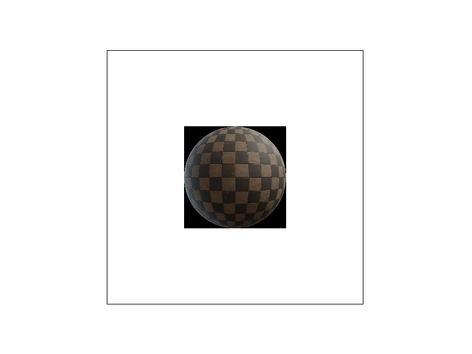    |
| **L_NEAREST + P_NEAREST**                         | **L_NEAREST + P_LINEAR**                        |
|  |  |

`L_ZERO` shows strong moiré / shimmering in the minified regions (undersampling), while `L_NEAREST` automatically selects coarser levels and removes most of the aliasing at the cost of a small discontinuity at level changes. Combining with `P_LINEAR` (i.e. trilinear filtering) makes both the level transitions and the texture interior smoother.

#### 7.4 Trade-offs

| Technique                             | Antialiasing power                                            | Speed                                       | Memory                                                     |
| ------------------------------------- | ------------------------------------------------------------- | ------------------------------------------- | ---------------------------------------------------------- |
| Supersampling (Task 2, `sample_rate`) | Improves **geometric** edges                                  | Sampling cost proportional to `sample_rate` | Coverage scheme: same as plain; per-sample: x`sample_rate` |
| Pixel sampling (Task 5, `psm`)        | Bilinear improves **magnification**, reduces texture aliasing | Bilinear approx. 4 texel reads vs. 1        | None                                                       |
| Level sampling (Task 6, `lsm`)        | Greatly improves **minification** aliasing                    | Trilinear approx. 2x bilinear               | Mipmap pyramid adds approx. 1/3 texture memory             |

#### 7.5 Extra Credit

The extra filtering methods extra credit (10 pts) was **not** implemented. A natural next step would be anisotropic filtering (e.g. EWA or a Ripmap pyramid with independent u/v scaling).

## 8. Conclusion and Known Limitations

All six tasks are implemented and share a single, well-factored rasterization loop. In a full regression over the 32 SVG test inputs, most cases match the reference images byte-for-byte; the few remaining cases differ only in a handful of **boundary pixels** (shared triangle edges, near-degenerate triangles, and texel rounding), with the interiors pixel-identical. These are floating-point tie-breaking differences and do not affect visual or functional correctness.

The extra-credit status is summarized below.

| Extra credit item                            | Points | Status                                                  |
| -------------------------------------------- | ------ | ------------------------------------------------------- |
| Task 1: z-buffer with two alpha triangles    | 10     | **Completed** (z-buffer + alpha compositing)            |
| Task 2: alternative antialiasing methods     | 5      | Not completed                                           |
| Task 2: supersampling with no extra memory   | 5      | **Completed** (coverage compositing)                    |
| Task 6: additional texture filtering methods | 10     | Not completed                                           |
